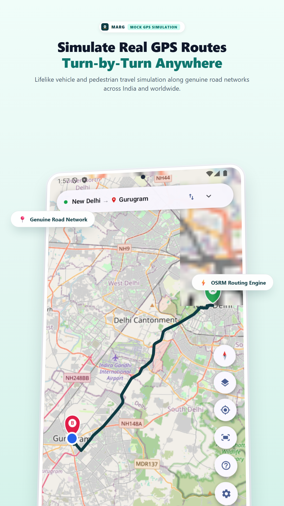
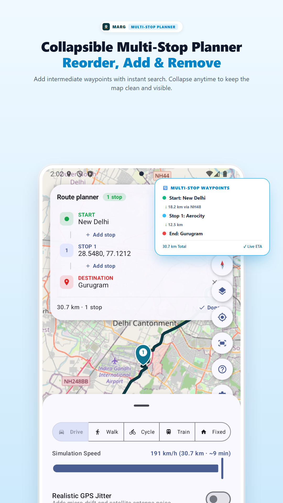
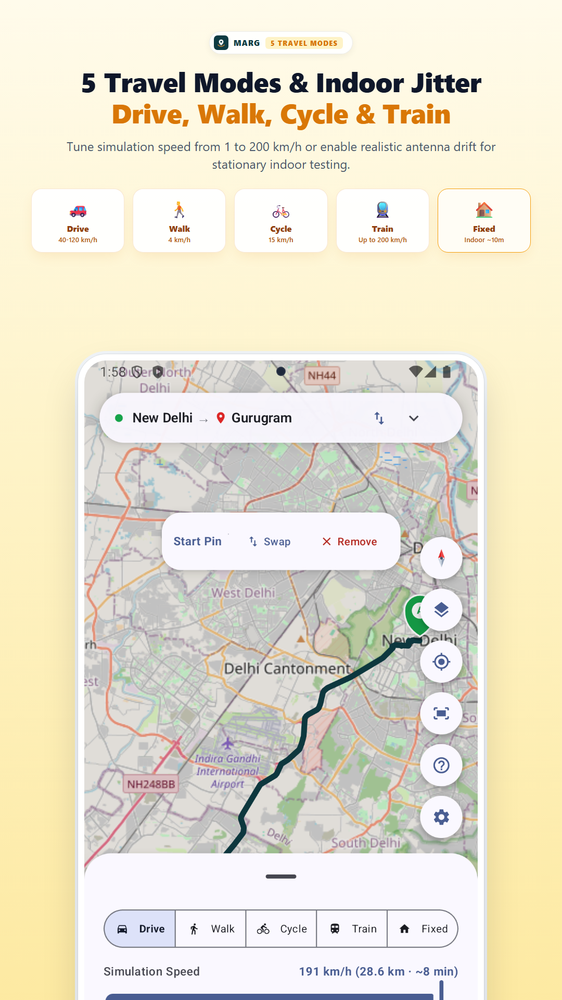
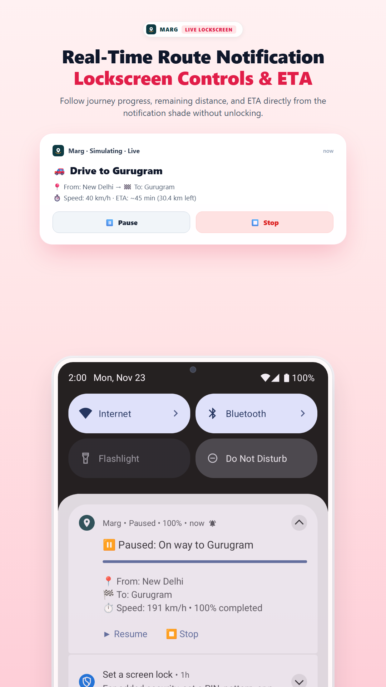
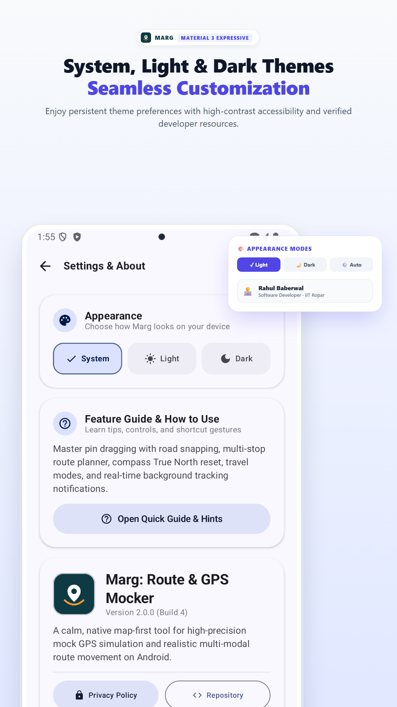
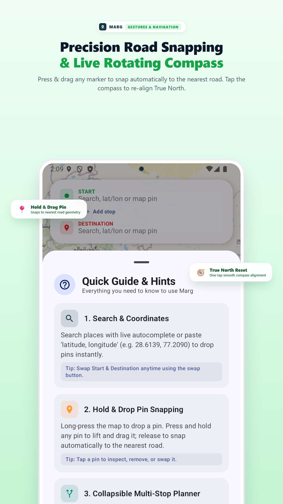
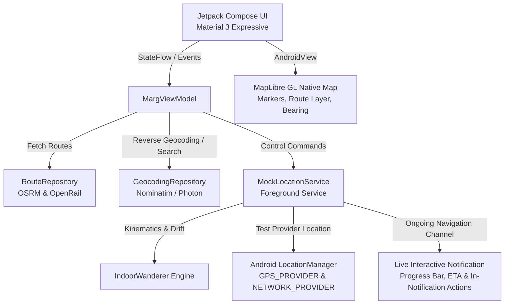

# Marg – Fake GPS & Route Mocker for Android

[-0E3B43?style=for-the-badge)](https://github.com/RahulBaberwal/marg/releases)
[](LICENSE)
[-FF9933?style=for-the-badge&logo=android)](https://developer.android.com)
[](https://developer.android.com/jetpack/compose)
[](https://indusapp.store/3y8hrlz0)

**Package:** `com.rahulbaberwal.marg`  
**Website & Documentation:** [rahul-baberwal.github.io/marg](https://rahul-baberwal.github.io/marg/)

Marg is a calm, native, map-first Android utility designed for developers, QA engineers, and testers who need high-precision mock GPS simulation and multi-modal route movement with zero clutter.

---

## ✨ Key Features

### 🚗 🚶 🚲 🚆 5 Simulation Modes
* **Drive (Default):** Realistic automotive road routing for cars, cabs, and delivery vehicles up to 200 km/h.
* **Walk:** Follows pedestrian footpaths, sidewalks, and walking trails with natural walking pace.
* **Cycle:** Routes through bike-friendly lanes, roads, and trails.
* **Train:** Navigates along authentic OpenStreetMap railway tracks with automatic road fallback.
* **Fixed Location:** Simulates stationary presence with natural room-to-room walking jitter—no destination route required.

### 🏠 Realistic Indoor Walking Jitter & Drift
Anti-cheat engines and presence-tracking platforms easily detect frozen GPS coordinates or high-frequency jumping noise. Marg's indoor jitter engine simulates authentic human movement:
* **Organic room-to-room drift:** Alternates naturally between resting in a room ($0\text{ m/s}$ with subtle satellite antenna noise) and transitioning between rooms ($0.8\text{–}1.2\text{ m/s}$ human walking pace).
* **Smooth kinematics:** Inertia-based heading changes with continuous velocity vectors—zero coordinate teleportation.
* **Configurable boundary radius:** Set your indoor wander zone from $0\text{ m}$ (strict stationary coordinate) to $30\text{ m}$ (full house or office).
* **Rich Android GPS metrics:** Injects authentic horizontal accuracy ($4\text{m}–16\text{m}$), barometric altitude drift, and Android 8.0+ metadata (`bearingAccuracy`, `speedAccuracy`, `verticalAccuracy`).

### 🔔 Live Interactive Route Notification
* **Pinned Ongoing Route Card:** Registered under high-priority navigation foreground channel (`marg_live_route_v1`), staying at the top of the shade.
* **Live Progress Bar:** Real-time animated progress bar tracking journey completion percentage.
* **Live ETA & Distance:** Real-time remaining distance in km, speed in km/h, and remaining ETA in minutes, updated every 2 seconds.
* **Interactive In-Notification Actions:** Pause movement and hold current location with micro-jitter, resume route simulation, or stop safely directly from the shade without opening the app.

### 📍 Multi-Stop Route Planner & Minimal Footprint
* **Collapsible ~52dp Route Pill:** Compresses into a sleek single row (`🟢 Start → 🔴 Destination (N stops) ⇅ ⌄`), keeping almost 100% of the map visible.
* **Intermediate Waypoints:** Add, inspect, and remove stops between Start and Destination with inline `+ Add stop` buttons.
* **Draggable Pins:** Grab and drag Start, Waypoints, or Destination pins across the map with elevation lift shadows and tactile haptics. Snaps to the nearest road on release.

### 🧭 Real-Time Compass & Layer Picker
* **Rotating Compass Needle:** Real-time compass button rotates with map camera bearing (`rotationZ = -mapBearing`). Tapping resets orientation to true North with haptics.
* **Multi-Layer Map Engine:** Switch seamlessly between Standard, Satellite, Terrain, and Dark map layers powered by MapLibre GL Native.

---

## 📸 Screenshots

| 1. Simulate GPS Routes | 2. Multi-Stop Planner | 3. 5 Travel Modes & Jitter |
|:---:|:---:|:---:|
|  |  |  |

| 4. Real-Time Notification | 5. Material 3 Theming | 6. Gestures & Compass |
|:---:|:---:|:---:|
|  |  |  |

---

## 🛠️ How to Setup Mock Location in 4 Steps

1. Enable **Developer Options** in your Android device settings:
   `Settings > About Phone > Tap "Build number" 7 times`.
2. Go to `Settings > System > Developer options`, find **Select mock location app**, and pick **Marg**.
3. Open **Marg** and choose your desired mode: **Drive**, **Walk**, **Cycle**, **Train**, or **Fixed**.
4. Set Start and Destination using search, coordinate paste, or long-pressing on the map, then tap **Start**.
5. Switch to Google Maps, Uber, or the application you are testing to see live simulated movement!

---

## 🏗️ Architecture & Tech Stack



* **UI Layer:** 100% Jetpack Compose with Material 3 Expressive design tokens, edge-to-edge system insets, and predictive back support.
* **Map Engine:** MapLibre GL Native (`org.maplibre.gl:android-sdk:11.8.4`) embedded inside Compose with real-time polyline rendering, dynamic bearing rotation, and animated camera updates.
* **Routing Services:** OpenStreetMap OSRM routing engine (Car, Bicycle, Foot) and OpenRailRouting for railway tracks.
* **Geocoding:** OpenStreetMap Nominatim and Photon with debounced queries biased toward India and nearby-first ranking.
* **Mock Provider:** Foreground service feeding high-fidelity coordinates, speeds, bearings, and accuracy metadata directly to Android's `LocationManager.GPS_PROVIDER` and `NETWORK_PROVIDER`.
* **Build Target:** `compileSdk 36`, `targetSdk 36`, `minSdk 26` (Android 8.0 Oreo up to Android 15 & 16).

---

## 💻 Building from Source

### Prerequisites
* Android Studio Koala Feature Drop or newer
* JDK 17 (recommended: Eclipse Temurin or Azul Zulu)
* Android SDK 36 platform and build-tools installed

### Build Commands
```bash
# Clone repository
git clone https://github.com/RahulBaberwal/marg.git
cd marg

# Build debug APK
./gradlew assembleDebug

# Build signed release APK and App Bundle (requires keystore.properties)
./gradlew assembleRelease bundleRelease
```

Release builds output to:
* **APK:** `app/build/outputs/apk/release/app-release.apk`
* **AAB:** `app/build/outputs/bundle/release/app-release.aab`

---

## 🔒 Privacy & Data Safety

* **Zero Tracking:** No advertising SDKs, analytics frameworks, or tracking libraries included.
* **No Account Required:** No registration, login, or personal information needed.
* **Local Processing:** Your real physical coordinates are never transmitted, recorded, or stored on any server.

---

## 👨‍💻 Developer & Open Source Credits

* **Developer:** [Rahul Baberwal](https://rahulbaberwal.com)
* **GitHub:** [@RahulBaberwal](https://github.com/RahulBaberwal)
* **LinkedIn:** [/in/rahul-baberwal](https://www.linkedin.com/in/rahul-baberwal/)
* **Instagram:** [@rahulbaberwal.in](https://www.instagram.com/rahulbaberwal.in/)
* **Email:** [im@rahulbaberwal.com](mailto:im@rahulbaberwal.com)

### Open Source Acknowledgments
* [OpenStreetMap](https://www.openstreetmap.org/) contributors (ODbL)
* [MapLibre GL](https://maplibre.org/) Native SDK
* [Project OSRM](http://project-osrm.org/) Routing Engine

---

## 📜 License

This project is licensed under the **GNU General Public License v3.0 (GNU GPL-3.0-only)**. See the [LICENSE](LICENSE) file for the full license text.

